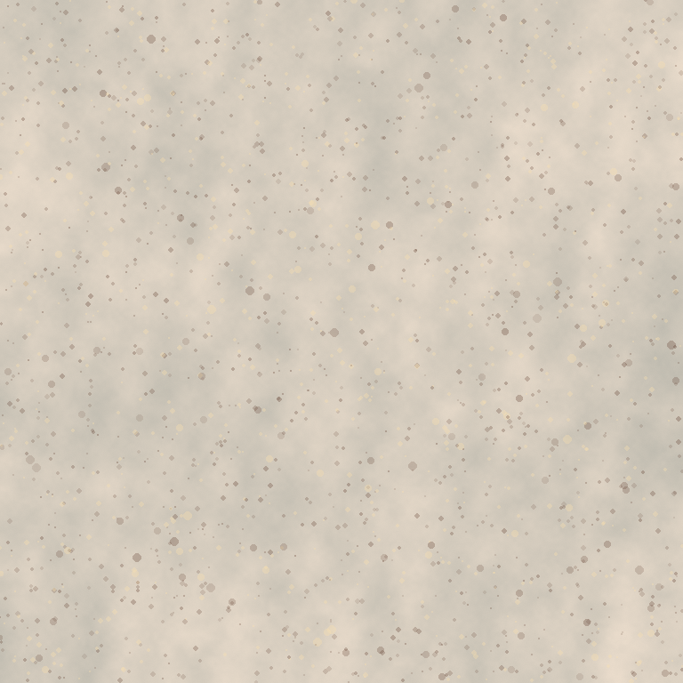

# MISSÃO MARTE — Rover Explorador + Drone de Quatro Hélices
Trabalho Prático de Computação Gráfica | Ciência da Computação | 2026/02  

Aplicação tridimensional em Python, Pygame e OpenGL 3.3, com estrutura gráfica própria baseada nos conceitos de *Developing Graphics Frameworks with Python and OpenGL*, de Lee Stemkoski e Michael Pascale (2022).



## 1. Instalação e execução
1. Instale **Python 3.12 (64 bits)**, marcando **“Add python.exe to PATH”** na instalação, se necessário.

2. Extraia o arquivo ZIP para uma pasta do computador.

3. Execute o arquivo `INICIAR_WINDOWS.bat`.

4. Na primeira execução, o iniciador cria uma pasta `.venv` com **Python 3.12** e instala `pygame`, `PyOpenGL` e `numpy` automaticamente. **A primeira execução requer internet para baixar essas bibliotecas.** Nas execuções seguintes, é só clicar no mesmo arquivo.

**Requisito da máquina:** computador com driver de vídeo que ofereça suporte a **OpenGL 3.3 ou superior**.

Se preferir usar o terminal no Windows:

```powershell

py -3.12 -m venv .venv

.venv\Scripts\python.exe -m pip install --only-binary=:all: -r requirements.txt

.venv\Scripts\python.exe main.py

```

### Linux e macOS
No terminal, entre na pasta do projeto e execute:

```bash

bash INICIAR_LINUX_MAC.sh

```

No Linux, tenha uma sessão gráfica e drivers OpenGL funcionando. No macOS, OpenGL é uma tecnologia legada, mas há suporte a OpenGL 3.3 Core em muitos computadores; verifique a compatibilidade.

### Ajuste de desempenho
Reduza a resolução das sombras e da janela:

```bash

python main.py --shadow 1024 --width 1000 --height 600

```

No Windows, se estiver usando o iniciador, pode passar os parâmetros assim:

```powershell

.\INICIAR_WINDOWS.bat --shadow 1024 --width 1000 --height 600

```

## 2. Controles
| Tecla | Ação |

|---|---|

| `W`, `A`, `S`, `D` | Deslocar o ponto de observação da câmera |

| Setas | Orbitar / inclinar a câmera |

| `Q` / `E` | Aproximar / afastar a câmera |

| `R` / `F` | Elevar / abaixar a câmera |

| Arrastar botão esquerdo do mouse | Girar a câmera livremente |

| Roda do mouse | Zoom |

| `1`, `2`, `3` | Ângulos predefinidos (cinematográfico, superior, lateral) |

| `C` | Ligar/desligar câmera seguindo o rover |

| `P` | Pausar e retomar a **animação** (câmera e cena permanecem visíveis) |

| `H` | Mostrar/ocultar a interface de missão |

| `F9` | Salvar `captura_missao_marte.png` na pasta do projeto |

| `ESC` | Encerrar |

## 3. Descrição da cena e da animação
A cena representa uma missão autônoma em Marte. O rover tem seis rodas, sensor estereoscópico, antena giratória e painéis solares; o drone tem quatro hélices giratórias, câmera e luzes de sinalização. O terreno tem rochas, uma cratera, montanhas, marcações de rota e uma zona de inspeção.

As **8 etapas são programadas e coordenadas**, não são duas animações independentes:

1. Inicialização, decolagem do drone.

2. Travessia: rover avança girando as rodas; drone acompanha em formação.

3. Rover detecta o alvo, para e autoriza inspeção.

4. Drone voa até a rocha, orbita o alvo e ativa o pulso de leitura.

5. Drone retorna ao rover.

6. Só então a rota é liberada.

7. Rover muda de rota e retoma a exploração, acompanhado pelo drone.

8. A missão termina e a sequência reinicia.

A animação utiliza **tempo decorrido em segundos (`delta time`)**, não deslocamento fixo por frame. Pausar congela as etapas e os movimentos dos objetos, mas permite controlar a câmera.

## 4. Atendimento aos requisitos do enunciado
| Requisito | Implementação concreta | Onde está |

|---|---|---|

| 1. Dois modelos 3D reconhecíveis e ambiente | Rover com 6 rodas, drone quadrirotor, solo e rochas | `models/world.py`: `Rover`, `Drone`, `Environment` |

| 2. Animação temporal e interação | Máquina de estados com inspeção condicionada à parada e retorno | `framework/mission.py`: `Mission.sample()` |

| 3. Translação, rotação, escala, hierarquia | Nós pais/filhos, rodas, hélices, mastros e painéis solares | `framework/math3d.py`, `framework/scene.py` |

| 4. Câmera perspectiva, teclado, pausa | OrbitCamera, teclado/mouse e pausa independente | `framework/camera.py`, `main.py` |

| 5. Textura de imagem + UVs | Solo com PNG autoral e coordenadas UV repetidas | `assets/mars_ground.png`, `framework/geometry.py` |

| 6. Luz direcional, materiais, normais | Iluminação difusa e especular, materiais e normais dos vértices | `shaders/scene.vert`, `shaders/scene.frag` |

| 7. Sombra dinâmica por shadow mapping | Depth pass no framebuffer da luz (2048²) + PCF 3x3 | `framework/renderer.py`: `ShadowMap`, `MarsRenderer.render()`; `shaders/depth.*`, `shaders/scene.frag` |

**Sombra projetada não é a mesma coisa que sombreamento da superfície:** a iluminação difusa/especular varia com as normais da superfície. Já a sombra projetada verifica a profundidade da geometria do ponto de vista da luz e escurece superfícies que ficam ocluídas (shadow mapping com PCF).

**Não foram usadas física de corpos rígidos nem colisões,** que são opcionais no enunciado. A interação é sincronizada por estados.

## 5. Organização dos arquivos
```text

Missao_Marte_3D/

├── main.py                       # Loop de tempo, entrada e integração

├── requirements.txt              # Dependências

├── INICIAR_WINDOWS.bat           # Dois cliques para instalar e iniciar

├── INICIAR_LINUX_MAC.sh          # Iniciador Unix

├── README.md                     # Esta documentação

├── framework/

│   ├── camera.py                 # Câmera em perspectiva

│   ├── geometry.py               # Cube/cylinder/sphere/cone/ring/terrain, UV e normais

│   ├── math3d.py                 # Matrizes, câmera e transformações

│   ├── scene.py                  # Node, Mesh, Material (grafo hierárquico)

│   ├── mission.py                # Estados e trajetórias temporais

│   ├── renderer.py               # OpenGL, VBO, VAO, texturas e shadow mapping

│   └── hud.py                    # Painel de telemetria

├── models/

│   └── world.py                  # Modelagem 3D autoral dos dois objetos e do ambiente

├── shaders/

│   ├── scene.vert / scene.frag   # Iluminação e sombras por PCF

│   ├── depth.vert / depth.frag   # Passagem de profundidade da luz

│   ├── screen.vert               # Quad de tela cheia

│   ├── sky.frag                   # Céu marciano

│   └── overlay.frag               # HUD por textura RGBA

├── assets/

│   ├── mars_ground.png           # Textura autoral incluída

│   └── gerar_textura.py          # Gerador opcional; requer Pillow

└── tests/

    └── test_project.py           # Testes unitários de geometria e interação

```

## 6. Como o framework foi organizado
O livro **Developing Graphics Frameworks with Python and OpenGL** apresenta conceitos como geometria, atributos de vértices, materiais, shaders, objetos 3D, câmera, grafo de cena e shadow mapping. Aqui esses conceitos foram reunidos em um **miniframework próprio e autocontido**, com funções/classes de responsabilidades equivalentes.

### Atributos de vértice
`framework/geometry.py` produz vértices com **8 números float32**:

- `layout(location=0) in vec3 aPosition` → posições 3D.

- `layout(location=1) in vec3 aNormal` → normais para iluminação.

- `layout(location=2) in vec2 aUV` → coordenadas da textura.

`framework/renderer.py` cria VAO/VBO/EBO e os liga com `glVertexAttribPointer`.

### Uniforms dos shaders
- `uModel`: transformação local → mundo da malha.

- `uView`: transformação do mundo → câmera.

- `uProjection`: projeção perspectiva.

- `uLightSpace`: projeção e câmera da fonte de luz direcional.

- `uLightDirection`: direção da luz solar.

- `uCameraPos`: posição da câmera para reflexão especular e neblina.

- `uColor`, `uRoughness`, `uEmission`: material.

- `uTexture` e `uHasTexture`: mapa de imagem.

- `uShadowMap`: textura de profundidade da luz.

### Shadow mapping (seção 6.9)
1. Monta uma câmera ortográfica na direção da fonte luminosa.

2. Desenha as geometrias que projetam sombra em uma textura de **profundidade** associada a um FBO.

3. Desenha a cena pela câmera do usuário, projetando cada ponto no espaço da luz.

4. Compara a profundidade projetada com a textura de sombras (`sampler2DShadow`).

5. Usa PCF de 9 amostras para suavizar as bordas.

6. Recalcula o mapa de profundidade a cada quadro: a sombra acompanha o rover e o drone.

## 7. Testes e ferramentas
Para verificar a lógica e geometria (sem iniciar a janela):

```bash

python -m unittest discover -s tests -v

```

Para abrir e fechar automaticamente após 3 quadros (útil como teste gráfico em uma máquina com OpenGL 3.3):

```bash

python main.py --frames 3 --screenshot teste_marte.png

```

## 8. Identificação e desenvolvimento

**Aluno:** Pedro Maciel Gonçalves da Silva  
**Curso:** Ciência da Computação  
**Período:** 2026/02  
**Temas:** 18 — Rover Explorador; 3 — Drone de Quatro Hélices.

### Contribuição individual

O desenvolvimento do projeto foi realizado individualmente, abrangendo a modelagem tridimensional do rover e do drone, a composição do ambiente marciano, a integração dos movimentos por etapas e a configuração da câmera e dos controles. O trabalho também contempla a aplicação de transformações geométricas, texturas, iluminação direcional e sombras dinâmicas por shadow mapping, além da organização dos arquivos e da documentação técnica. Foram utilizados recursos de inteligência artificial como apoio à implementação, conforme declarado a seguir.

### Declaração de uso de inteligência artificial
> Foi utilizada a ferramenta **ChatGPT (OpenAI)** como apoio à elaboração da implementação inicial de `main.py`, dos módulos em `framework/` e `models/`, dos shaders GLSL em `shaders/`, da textura autoral em `assets/` e da documentação.

### Fontes
- STEMKOSKI, Lee; PASCALE, Michael. **Developing Graphics Frameworks with Python and OpenGL**. CRC Press, 2022. DOI: 10.1201/9781003181378.

- Documentação oficial do **Python**, **Pygame**, **OpenGL** e **GLSL**&#x20;

- Os recursos gráficos e o código do projeto foram elaborados para esta atividade, com apoio de inteligência artificial, sem utilização de modelos 3D externos.
